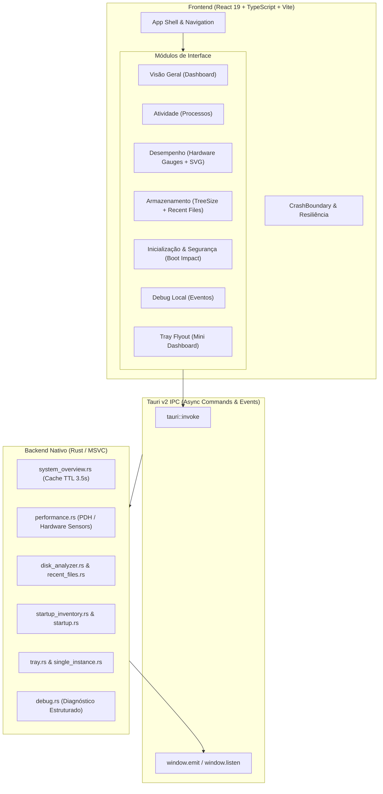

# AGENTS.md — Diretrizes e Arquitetura do Pulse

Este documento define os padrões técnicos, restrições arquiteturais e diretrizes de desenvolvimento para agentes autônomos e desenvolvedores que atuam no repositório **Pulse**.

---

## 1. Visão do Produto e Identidade Unificada

O **Pulse** é uma central nativa Windows-first para observabilidade, diagnóstico e controle local do sistema operacional Windows 11. O objetivo do Pulse é substituir a fragmentação de ferramentas isoladas (Gerenciador de Tarefas, Monitor de Recursos, TreeSize, Sysinternals Autoruns e Visualizador de Eventos) por uma **experiência fluida, unificada, contextualizada e orientada a explicar o sistema**.

### Princípios Fundamentais (Invioláveis)
1. **Dados 100% Locais e Privados**: Sem telemetria para nuvem, sem criação de conta e sem dependência de servidores externos.
2. **Honestidade em Métricas (Zero Fake Data)**:
   - Se uma métrica ou sensor não for suportado pelo hardware/driver, o valor deve ser explicitamente marcado como **Indisponível** acompanhado de justificativa técnica (`unavailableReason`).
   - **É estritamente proibido exibir zero (`0`, `0%`, `0°C`) como fallback fictício.**
3. **Evidência Transparente sem Falso Alarme**:
   - Módulos de segurança e inspeção apontam evidências técnicas e anomalias verificadas, **nunca** rotulam executáveis arbitrariamente como malware.
4. **Segurança Operacional e Ações Não Destrutivas**:
   - Operações potencialmente destrutivas (exclusão forçada de arquivos, `reg delete` de chaves de boot) são proibidas.

---

## 2. Mapa Arquitetural do Sistema

O Pulse combina um backend nativo em **Rust com Tauri v2** e um frontend reativo em **React 19, TypeScript e Vite**.



---

## 3. Diretrizes de Desempenho e Eficiência Extrema

O Pulse roda continuamente em segundo plano e deve manter pegada mínima de memória (< 80 MB de Working Set) e uso próximo a 0% de CPU em repouso.

### 3.1. Proteção de I/O e DPC no Windows (Scanner de Arquivos)
- **Problema**: Varreduras recursivas em disco disparam o filtro de antivírus do Windows (`WdFilter.sys`), enfileiram DPCs e provocam micro-travamentos no cursor do mouse.
- **Regras Obrigatórias**:
  - Toda operação de filesystem recursiva deve rodar em `tauri::async_runtime::spawn_blocking`.
  - Impor limites rígidos de varredura: profundidade máxima `MAX_DEPTH = 3`, cota de arquivos `MAX_FILES_TOTAL = 2500` e timeout de 1.5s por raiz.
  - Ignorar links simbólicos e junctions (`symlinks`).
  - Chamar explicitamente `std::thread::yield_now()` a cada 15 arquivos processados para liberar filas de I/O do kernel.

### 3.2. Análise de Disco TreeSize (Agregação e Podas de Árvore)
- **Problema**: Diretórios com centenas de milhares de nós saturam a ponte IPC e travam a árvore DOM.
- **Regras Obrigatórias**:
  - No Rust, ordenar filhos por tamanho decrescente e agrupar nós além do limite em nós sintéticos (`"Outros arquivos"` / `"Demais itens"`).
  - No React, não usar `setInterval` para dimensionamento de gráficos treemap; utilizar exclusivamente `ResizeObserver`.
  - Diferenciar claramente visualmente pastas pesadas de arquivos isolados gigantes.

### 3.3. Caching e Staggered Startup
- **Rust Cache**: Métricas de visão geral utilizam mutex com TTL curto (`CACHE_TTL = Duration::from_millis(3500)`). Não execute scripts PowerShell ou varreduras de processos em intervalos menores que o TTL.
- **Invalidação Reativa**: A alteração de pastas personalizadas em `%LOCALAPPDATA%\Pulse\custom-scan-folders.json` deve invalidar imediatamente o cache do backend (`CACHE`).
- **Inicialização Escalonada**: No carregamento do frontend, escalonar requisições iniciais e fornecer feedback imediato com skeletons e toasts de loading.

### 3.4. Renderização de Gráficos e SVG Leve
- Telemetria de 1s de intervalo exige isolamento de layout para prevenir layout thrashing:
  - Tags SVG devem usar `shape-rendering: geometricPrecision`.
  - Contêineres de gráficos devem utilizar CSS `contain: content; will-change: transform;`.
  - Gráficos devem ser encapsulados em `React.memo` customizado, comparando tamanho de histórico e último valor.
  - Buffers circulares de histórico devem ser retidos em `useRef` para não invalidar callbacks do ciclo de renderização.

---

## 4. Design System e Interface Moderna e Intuitiva

A interface do Pulse segue as diretrizes do **Windows 11 Fluent Design**: foco em clareza, superfícies escuras refinadas, tipografia limpa, hierarquia visual imediata e micro-interações responsivas.

### 4.1. Layout Fluido e Responsivo (Anti-padrão de Altura Fixa)
- **Proibido**: Alturas fixas em pixels (`height: 500px`, `height: 800px`) em containers principais, módulos ou listas de itens.
- **Padrão Obrigatório**:
  ```css
  display: flex;
  flex-direction: column;
  flex: 1;
  min-height: 0;
  height: 100%;
  ```
- Garanta que listas extensas (`.process-list`, `.recent-list`, `.tree-pane`) usem `overflow-y: auto` e `min-height: 0` para scroll independente sem romper o shell da aplicação.

### 4.2. Integração com a Bandeja do Sistema (Tray Flyout)
- A janela `tray-flyout` exibe um resumo compacto e deve se comportar como um flyout nativo do Windows:
  - Monitorar `WindowEvent::Focused(false)` no Tauri para ocultar a janela imediatamente quando o usuário clicar fora.
  - No fechamento da janela principal (`WindowEvent::CloseRequested`), interceptar o evento e consultar preferências do usuário ou exibir confirmação para minimizar na bandeja.

### 4.3. Resiliência e Tratamento Defensivo de Dados
- **TypeScript vs Rust Option**: Rust `Option::None` serializa como `null` no JSON.
  - Tratar ausência sempre com `value != null` (cobre tanto `null` quanto `undefined`).
  - Na formatação de métricas, validar defensivamente:
    ```typescript
    if (v == null || typeof v !== "number" || Number.isNaN(v)) {
      return "Indisponível";
    }
    ```
- **Error Boundaries**: Todas as visões principais devem estar sob o `CrashBoundary`. Se um módulo falhar, exiba fallback contextual com botão para restabelecer a "Visão geral", sem derrubar o shell da aplicação.

### 4.4. Conformidade Estrita com o Sistema de Temas (Claro e Escuro)
- **Proibição Absoluta de Cores Hardcoded**:
  - É estritamente proibido definir cores hexadecimais ou RGB fixas (`#141619`, `#191c20`, `#2b3138`, `#ffffff`, etc.) em propriedades de cor, fundo ou borda (`background`, `color`, `border`, `stroke`, `fill`) de componentes, telas ou arquivos CSS adicionais.
  - Cores fixas quebram imediatamente o tema claro (Porcelain), gerando cards escuros com texto ilegível.
- **Uso Obrigatório de Tokens Semânticos (`identity.css`)**:
  - Todo e qualquer elemento visual deve consumir exclusivamente as variáveis do Design System:
    - **Superfícies**: `var(--neu-surface)`, `var(--neu-surface-sunken)`, `var(--neu-surface-hover)`, `var(--neu-surface-active)`, `var(--neu-bg)`
    - **Bordas e Divisores**: `var(--neu-divider)`, `var(--neu-border-subtle)`
    - **Tipografia**: `var(--neu-text-title)`, `var(--neu-text-primary)`, `var(--neu-text-secondary)`, `var(--neu-text-muted)`
    - **Acentos e Status**: `var(--neu-accent)`, `var(--neu-accent-hover)`, `var(--neu-signal-secondary)`, `var(--neu-success)`, `var(--neu-warning)`, `var(--neu-danger)`
    - **Sombras Neumórficas**: `var(--neu-shadow-raised-xs)`, `var(--neu-shadow-raised-sm)`, `var(--neu-shadow-raised-lg)`, `var(--neu-shadow-inset-sm)`
    - **Trilhos e Barras**: `var(--neu-track-bg)`
- **Modais, Popups, Diálogos e Inputs**:
  - Backdrops, containers de diálogo (`.modal-card`, `.quota-modal-card`, `.cleanup-dialog`), formulários e inputs devem responder dinamicamente a `[data-theme]`, sem herdar fundos escuros do skin legado.
- **SVGs Inline e Gráficos**:
  - Elementos vetoriais devem utilizar `currentColor`, `var(--neu-divider)`, `var(--neu-surface)` ou variáveis dedicadas com fallbacks semânticos em vez de valores estáticos em `stroke` e `fill`.

---

## 5. Regras do Sistema Operacional (Windows Internals)

Ao interagir com subsistemas do Windows, aplique os seguintes padrões canônicos:

### 5.1. Inicialização do Windows (StartupApproved)
- **Nunca use `reg delete`**: Apagar a chave em `HKCU\...\Run` destrói a linha de comando do programa, impossibilita reativação pelo Gerenciador de Tarefas do Windows e corrompe o estado do sistema.
- **Padrão do Windows**:
  - Para desativar: atualizar a chave binária em `Software\Microsoft\Windows\CurrentVersion\Explorer\StartupApproved\Run` iniciando com o byte `0x03` seguido do timestamp binário.
  - Para ativar: atualizar o registro com o byte `0x02`.
- **Métricas de Boot**: Coletar dados de degradação através do log de eventos `Microsoft-Windows-Diagnostics-Performance/Operational` (IDs 101 e 102) para mapear o impacto real em milissegundos.

### 5.2. Pastas e Unidades de Armazenamento Personalizadas
- O escopo padrão de varredura abrange o diretório do usuário (`USERPROFILE`).
- Pastas adicionadas pelo usuário em outros discos (ex: `D:\Projetos`) devem ser persistidas em `%LOCALAPPDATA%\Pulse\custom-scan-folders.json` e mescladas em `roots()` no Rust para satisfazer tanto a varredura quanto a validação de segurança de caminhos (`canonicalize`).

---

## 6. Estrutura do Repositório (App + Landing Page Unificados)

```text
pulse/
├── src/                          # Frontend React 19 + TypeScript (App Desktop)
│   ├── App.tsx                   # Shell da aplicação, módulos e roteamento
│   ├── App.css                   # Sistema de estilos base
│   ├── identity.css              # Design System Neumórfico Mineral (Porcelain / Obsidian)
│   ├── Identity.tsx              # Marca PulseMark e ícones de módulos
│   ├── Charts.tsx                # Gráficos SVG otimizados e Hardware Gauges
│   ├── DiskAnalyzer.tsx          # Módulo TreeSize, Treemap e análise de capacidade
│   ├── DiskCleanup.tsx           # Limpeza local controlada por categorias seguras
│   ├── UninstallHub.tsx          # Desinstalação com Ponto de Restauração e resíduos
│   ├── ServicesHub.tsx           # Serviços do Windows (SCM) e atualizações Winget
│   ├── SubscriptionUsage.tsx     # Cotas de assinaturas de IA (5 provedores)
│   ├── QuotaHistory.tsx          # Histórico de cotas de 30 dias em SQLite
│   └── main.tsx                  # Ponto de entrada do React
├── src-tauri/                    # Backend nativo Rust (Tauri v2 / MSVC)
│   ├── src/
│   │   ├── lib.rs                # Registro de plugins, handlers e janelas Tauri
│   │   ├── main.rs               # Entrypoint binário
│   │   ├── system_overview.rs    # CPU, RAM, disco e top processos com cache
│   │   ├── performance.rs        # Sensores de hardware, GPU e telemetria
│   │   ├── disk_analyzer.rs      # Scanner TreeSize em árvore agregada
│   │   ├── disk_cleanup.rs       # Categorias seguras de limpeza local
│   │   ├── uninstall/            # Desinstalador, Restore Point e scanner de resíduos
│   │   ├── services.rs           # Leitura nativa SCM / WMI
│   │   ├── app_updates.rs        # Integração com winget upgrade
│   │   ├── subscription_usage.rs # Coleta local de cotas de IA + Keyring
│   │   ├── quota_history.rs      # Persistência SQLite de 30 dias
│   │   ├── audio.rs              # Mixer de volume Core Audio COM por aplicativo
│   │   ├── recent_files.rs       # Scanner de arquivos recentes resiliente a I/O
│   │   ├── startup_inventory.rs  # Inventário de boot e suporte a StartupApproved
│   │   ├── tray.rs               # Controle da bandeja e janela flyout
│   │   └── single_instance.rs    # Prevenção de execução múltipla
│   ├── Cargo.toml                # Dependências Rust
│   └── tauri.conf.json           # Configuração de capacidades, janelas e bundles
├── landing/                      # Landing Page Oficial Unificada (pulse.lagrimante.com.br)
│   ├── index.html                # Página completa com Simulador Interativo, SEO e JSON-LD
│   ├── src/                      # CSS neumórfico (base.css, components.css) e main.js
│   ├── public/                   # index.md, llms.txt, release.json e sitemap.xml (sem .exe)
│   ├── scripts/check-seo.mjs     # Auditoria automatizada de SEO, IA, JSON-LD e instalador
│   ├── worker.js                 # Cloudflare Worker (Content Negotiation Markdown + headers .exe)
│   └── wrangler.jsonc            # Configuração de deploy Cloudflare Workers
├── scripts/
│   ├── build-native.sh           # Ponte WSL -> Windows MSVC + NSIS + sync da Landing Page
│   ├── sync-landing.mjs          # Sincroniza .exe, versão, tamanho, SHA-256 e espelha em ../pulse-lp
│   ├── kill-running-app.mjs      # Encerra pulse-windows.exe antes do build (Windows e WSL)
│   └── run-installer.mjs         # Abre o instalador NSIS gerado (Windows e WSL)
├── memory/                       # Memória contínua com lições arquiteturais
└── AGENTS.md                     # Este documento canônico de referência
```

### 6.1. Fluxo de Build Nativa no WSL e Sincronização com a Landing Page
Como o repositório reside no WSL (`~/projects/pulse`), mas o backend Rust/Tauri requer o compilador MSVC (`link.exe`, `vcvars64.bat`) e NSIS no Windows:
1. `npm run build:native` (ou `npm run tauri:build`) compila o frontend no WSL (`dist/`), sincroniza os fontes para NTFS (`C:\Users\lucas\AppData\Local\Temp\pulse-src`) e compila o backend em `C:\Users\lucas\AppData\Local\Temp\pulse-target`.
2. Os artefatos compilados são copiados de volta para o WSL em:
   - Executável standalone: `src-tauri/target/release/pulse-windows.exe`
   - Instalador NSIS: `src-tauri/target/release/bundle/nsis/Pulse_<versão>_x64-setup.exe`
3. Automaticamente ao final do build, `scripts/sync-landing.mjs` lê `Pulse_<versão>_x64-setup.exe` do bundle, calcula tamanho e `SHA-256`, grava `installer.assetUrl` (GitHub Release `v<versão>`) em `landing/public/release.json`, atualiza `landing/index.html`, `landing/public/index.md` e `landing/public/llms.txt`, compila `landing/dist`, executa `check-seo.mjs` e espelha tudo em `../pulse-lp` (se presente). O `.exe` **nunca** é versionado: o script apaga cópias em `download/` e falha se o Git ainda rastrear alguma.
4. `npm run release:publish` envia o instalador para a GitHub Release `v<versão>` (só se o SHA-256 bater com `release.json`). O Worker redireciona `/download/Pulse-latest-x64-setup.exe` para esse asset; publique a Release **antes** de dar push no `pulse-lp`.
5. **Regra de Paridade Obrigatória**: Sempre que uma nova funcionalidade, módulo ou mudança de comportamento for adicionada ao aplicativo Pulse, a Landing Page (`landing/index.html`, `landing/public/index.md` e `landing/public/llms.txt`) **DEVE** ser atualizada na mesma tarefa.

---

## 7. Comandos de Desenvolvimento e Verificação

Sempre valide as alterações antes de finalizar qualquer intervenção:

| Comando | Finalidade |
| :--- | :--- |
| `npm test` | Executa a suíte de testes unitários do frontend (Vitest) |
| `npm run typecheck` | Validação estrita de tipos TypeScript (`tsc --noEmit`) |
| `npm run build` | Compilação completa do bundle do app (TypeScript + Vite) |
| `npm run verify` | Execução encadeada: typecheck, testes e build do app |
| `npm run build:native` | Build completa WSL -> Windows (Frontend + Rust MSVC + NSIS + Sync Landing Page) |
| `npm run tauri:build:install` | Executa `build:native` e abre o instalador NSIS no Windows |
| `npm run lp:sync` | Sincroniza versão, tamanho e SHA-256 do instalador com a Landing Page e valida SEO |
| `npm run release:publish` | Publica o instalador na GitHub Release `v<versão>` (`-- --clobber` substitui) |
| `npm run lp:dev` | Inicia servidor de desenvolvimento da Landing Page (`landing/`) |
| `npm run lp:check` | Executa auditoria de SEO, JSON-LD, `llms.txt` e instalador na Landing Page |

---

## 8. Checklist para Agentes Autônomos

Antes de entregar qualquer tarefa no Pulse, verifique:
- [ ] O código respeita a proibição de dados fictícios (`0` falso vs "Indisponível")?
- [ ] Qualquer operação de I/O em lote foi descarregada com `spawn_blocking` e `yield_now`?
- [ ] A interface mantém flexbox fluido sem alturas estáticas em pixels?
- [ ] Todos os elementos, telas, modais e formulários utilizam tokens de tema (`--neu-*` e `--theme-*`) sem cores hex/rgb fixas?
- [ ] Valores numéricos recebidos do IPC são sanitizados contra `null`/`undefined`/`NaN`?
- [ ] Novas funcionalidades ou módulos foram refletidos na Landing Page (`landing/`) e sincronizados com `npm run lp:sync` / `npm run build:native`?
- [ ] `npm test`, `npm run typecheck` e `npm run lp:check` executam com 100% de aprovação e zero alertas?
- [ ] Novas lições ou restrições foram registradas em `memory/<modulo>/<slug>.md`?

